# Arquitectura del sistema Hospital

Diagramas para entender cómo está construido el sistema: la base de datos, el backend, la seguridad y el frontend.
Están escritos en [Mermaid](https://mermaid.js.org/), así que GitHub e IntelliJ los muestran como imágenes directamente desde este archivo.

**Fuente de verdad:** el esquema sale de las migraciones de Flyway (`src/main/resources/db/migration`) y las reglas de acceso de `SecurityConfig`. Si cambian, hay que actualizar este documento.

## Contenido

1. [Vista general](#1-vista-general)
2. [Base de datos](#2-base-de-datos)
   - [Mapa de relaciones](#21-mapa-de-relaciones)
   - [Usuarios y seguridad](#22-usuarios-y-seguridad)
   - [Doctores, pacientes, citas e historial](#23-doctores-pacientes-citas-e-historial)
   - [Hospitalización, inventario y archivos](#24-hospitalización-inventario-y-archivos)
   - [Valores de los enums](#25-valores-de-los-enums)
   - [Restricciones e integridad](#26-restricciones-e-integridad)
   - [Migraciones](#27-migraciones-de-flyway)
3. [Backend](#3-backend)
   - [Capas](#31-capas)
   - [Paquetes](#32-paquetes)
   - [Controller → Service → Repository](#33-controller--service--repository)
   - [Recorrido de una petición](#34-recorrido-de-una-petición)
4. [Seguridad](#4-seguridad)
   - [Login y uso del access token](#41-login-y-uso-del-access-token)
   - [Renovación y logout](#42-renovación-del-token-y-logout)
   - [Permisos por rol](#43-permisos-por-rol)
5. [Ciclos de vida](#5-ciclos-de-vida)
6. [Frontend](#6-frontend)

---

## 1. Vista general

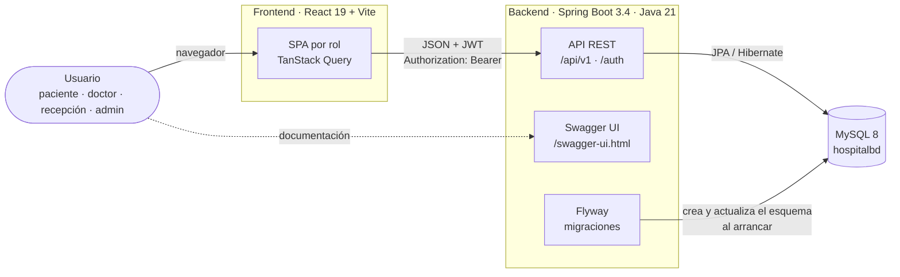

| Pieza | Tecnología | Dónde |
|---|---|---|
| Frontend | React 19, TypeScript, Vite, Tailwind CSS 4, TanStack Query, React Router | `frontend/` |
| Backend | Spring Boot 3.4 (Web, Security, Data JPA, Validation), JWT (jjwt), MapStruct, Lombok, OpenPDF | `src/main/java` |
| Base de datos | MySQL 8, esquema manejado por Flyway (`ddl-auto=validate`) | `docker-compose.yml` (desarrollo) |
| Documentación de la API | springdoc / Swagger | `/swagger-ui.html` |
| Pruebas | JUnit 5, Mockito, Testcontainers (MySQL real), JaCoCo | `src/test` |

---

## 2. Base de datos

### 2.1 Mapa de relaciones

Todas las tablas y cómo se conectan, sin columnas. Las secciones siguientes muestran el detalle por área.

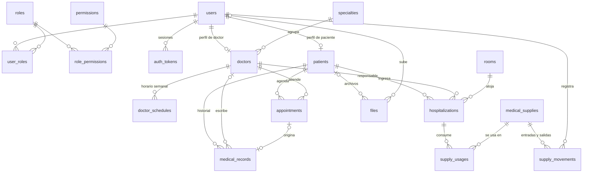

**Cómo leer las relaciones:** `||` = exactamente uno · `|o` = cero o uno · `o{` = cero o muchos.
Por ejemplo, `users ||--o| patients` significa que un paciente pertenece a exactamente un usuario, y que un usuario tiene como máximo un perfil de paciente.

**Idea central del modelo:** `users` guarda los datos de acceso (email, contraseña, nombre, activo) y los roles. Paciente y doctor son **perfiles** en tablas propias ligados a un usuario. El recepcionista y el administrador no tienen perfil: son solo un usuario con ese rol.

### 2.2 Usuarios y seguridad

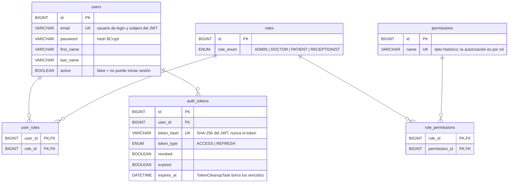

- `user_roles` y `role_permissions` son tablas intermedias de relaciones muchos a muchos.
- `auth_tokens` permite revocar tokens: un JWT con firma válida solo se acepta si su hash está aquí y no está revocado (ver [Seguridad](#4-seguridad)).

### 2.3 Doctores, pacientes, citas e historial

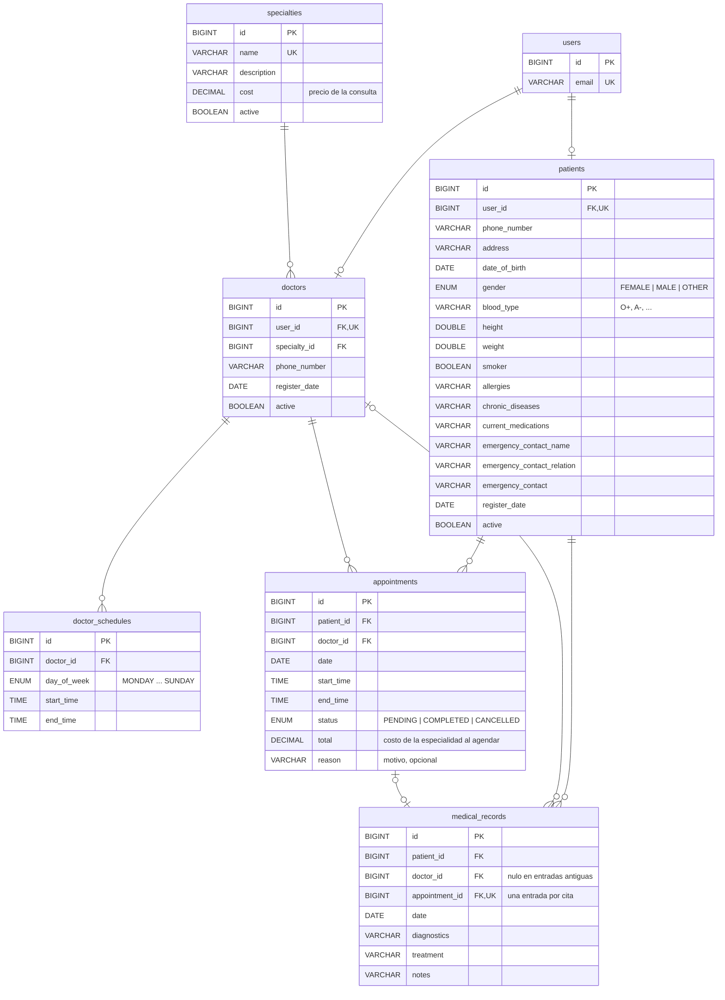

- `user_id` es **único** en `doctors` y `patients`: un usuario es como máximo un doctor o un paciente.
- Una entrada de `medical_records` solo se crea a partir de una cita `COMPLETED` del doctor autenticado, y solo una por cita (`appointment_id` único).
- `specialties.doctorCount` (doctores activos) no es una columna: Hibernate lo calcula con `@Formula`.

### 2.4 Hospitalización, inventario y archivos

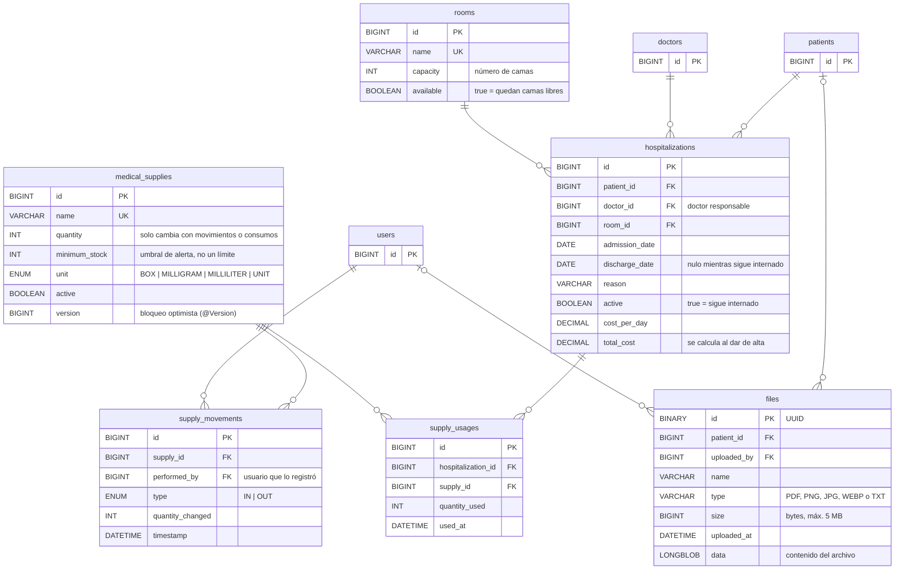

- Una sala admite tantos pacientes activos como su `capacity`. `rooms.occupiedBeds` se calcula con `@Formula` (hospitalizaciones activas en la sala).
- `total_cost` = `cost_per_day` × días internado (mínimo 1).
- El stock puede bajar hasta 0, nunca por debajo. Por debajo de `minimum_stock` el insumo aparece en el reporte `GET /medical-supplies/low-stock`.
- Los archivos se guardan dentro de la base (`LONGBLOB`). El listado lee solo los metadatos, sin cargar `data`.

### 2.5 Valores de los enums

Todos se guardan como **texto** (`@Enumerated(EnumType.STRING)`), no como número.

| Columna | Valores |
|---|---|
| `roles.role_enum` | `ADMIN`, `DOCTOR`, `PATIENT`, `RECEPTIONIST` |
| `auth_tokens.token_type` | `ACCESS`, `REFRESH` |
| `appointments.status` | `PENDING`, `COMPLETED`, `CANCELLED` |
| `doctor_schedules.day_of_week` | `MONDAY` … `SUNDAY` |
| `patients.gender` | `FEMALE`, `MALE`, `OTHER` |
| `patients.blood_type` | `A+`, `A-`, `B+`, `B-`, `AB+`, `AB-`, `O+`, `O-` (texto, con `BloodTypeConverter`) |
| `medical_supplies.unit` | `BOX`, `MILLIGRAM`, `MILLILITER`, `UNIT` |
| `supply_movements.type` | `IN`, `OUT` |

### 2.6 Restricciones e integridad

| Regla | Cómo se garantiza |
|---|---|
| Email, nombre de especialidad, sala e insumo únicos | Índices `UNIQUE` |
| Un usuario tiene como máximo un perfil de paciente o de doctor | `UNIQUE (user_id)` en `patients` y `doctors` |
| Un doctor no tiene dos citas que empiecen a la misma hora | Índice único funcional `uk_appointments_doctor_slot (doctor_id, date, start_time)` que **ignora las canceladas**, así un horario cancelado se puede volver a reservar |
| Las citas no se solapan (para el doctor ni para el paciente) | Validación en `AppointmentService`, con bloqueo pesimista de la fila del doctor al agendar o reprogramar |
| Una entrada de historial por cita | `UNIQUE (appointment_id)` en `medical_records` |
| Dos usuarios no descuentan el mismo stock a la vez | `@Version` en `medical_supplies` → 409 si hubo un cambio concurrente |
| No se borran registros clínicos | Pacientes, doctores, especialidades e insumos se **desactivan** (`active = false`) en lugar de borrarse |

### 2.7 Migraciones de Flyway

Flyway aplica estos scripts en orden al arrancar la aplicación y registra cuáles ya corrió en la tabla `flyway_schema_history`. Hibernate solo **valida** que las entidades coincidan con el esquema (`ddl-auto=validate`), nunca lo modifica.

| Versión | Archivo | Qué hace |
|---|---|---|
| V1 | `V1__baseline.sql` | Esquema inicial completo |
| V2 | `V2__enums_como_texto.sql` | `appointments.status` y `doctor_schedules.day_of_week` pasan de número a texto |
| V3 | `V3__concurrencia_e_integridad.sql` | `version` en insumos e índice único de citas por doctor y horario |
| V4 | `V4__reglas_negocio_y_api.sql` | Motivo de cita, costos de hospitalización, `medical_records` con doctor y cita, `unit`, `gender` como enum, archivos ligados a paciente, `expires_at` en tokens |
| V3.1, V4.1 | `db/dev-data/*.sql` | Datos de prueba. **Solo en el perfil `local`** |

---

## 3. Backend

### 3.1 Capas

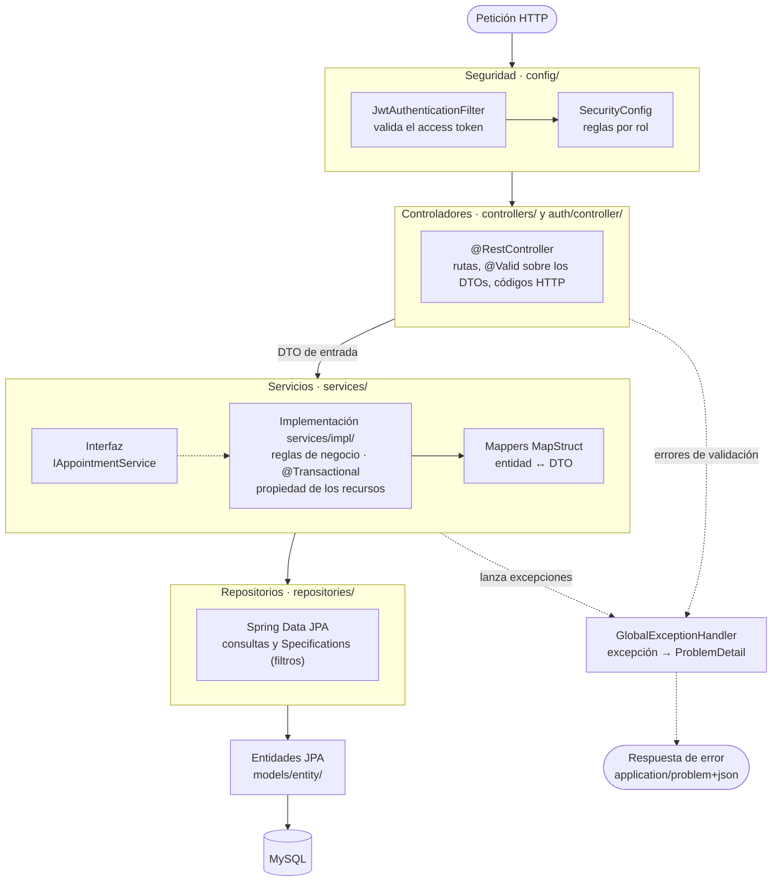

| Capa | Responsabilidad | No debe |
|---|---|---|
| **Controller** | Recibir la petición, validar el formato del DTO (`@Valid`), obtener el usuario autenticado y devolver el código HTTP correcto | Tener reglas de negocio ni acceder a repositorios |
| **Service** | Reglas de negocio, transacciones, verificar que el usuario sea dueño del recurso, convertir con los mappers | Saber de HTTP |
| **Repository** | Leer y escribir en la base (Spring Data JPA) | Tener lógica |
| **Entity** | Representar una tabla | Exponerse en la API: siempre se responde con DTOs |
| **DTO** | Forma de los datos que entran y salen de la API | — |

**Errores:** los servicios lanzan excepciones propias (`EntityNotFoundException` → 404, `InvalidDataException` → 400, `ConflictException` → 409, `AccessDeniedException` → 403, `@Version` en conflicto → 409, cualquier otro error → 500 sin detalles internos). `GlobalExceptionHandler` las convierte en un JSON `ProblemDetail`:

```json
{
  "title": "Datos inválidos",
  "status": 400,
  "detail": "La cita está fuera del horario del doctor",
  "instance": "/api/v1/appointments",
  "errors": [{ "field": "date", "message": "..." }]
}
```

### 3.2 Paquetes

```
com.hospital.backendHospital
├── auth/
│   ├── controller/      AuthController (/auth: register, login, refresh-token)
│   ├── service/         AuthService, JwtService, TokenService, TokenCleanupTask
│   └── repository/      Token (entidad de auth_tokens) y TokenRepository
├── config/              SecurityConfig, JwtAuthenticationFilter, SecurityErrorHandler,
│                        AppConfig, OpenApiConfig, DataSeeder (roles y admin inicial)
├── controllers/         Un controlador REST por recurso (/api/v1/...)
├── services/            Interfaces I*Service
│   ├── impl/            Implementaciones (reglas de negocio)
│   └── validation/      ScheduleValidator
├── repositories/        Repositorios Spring Data JPA
├── mappers/             Mappers MapStruct (entidad ↔ DTO)
├── models/
│   ├── entity/          Entidades JPA y enums
│   ├── dto/             DTOs de entrada y salida, agrupados por recurso
│   └── filters/         Parámetros de búsqueda de los listados
└── exceptions/          Excepciones propias y GlobalExceptionHandler
```

### 3.3 Controller → Service → Repository

| Controlador (ruta) | Servicio | Repositorios que usa el servicio |
|---|---|---|
| `AuthController` (`/auth`) | `AuthService` | `UserRepository`, `RoleRepository`, `TokenRepository` (vía `TokenService`) |
| `AccountController` (`/account`) | `AccountService` | `UserRepository`, `PatientRepository`, `DoctorRepository` |
| `DashboardController` (`/dashboard`) | `DashboardService` | `PatientRepository`, `DoctorRepository`, `AppointmentRepository`, `HospitalizationRepository`, `RoomRepository`, `MedicalSupplyRepository` |
| `PatientController` (`/patients`) | `PatientService`, `PDFGeneratorService` | `PatientRepository`, `UserRepository`, `RoleRepository`, `AppointmentRepository`, `HospitalizationRepository`, `MedicalRecordRepository` |
| `DoctorController` (`/doctors`) | `DoctorService` | `DoctorRepository`, `DoctorScheduleRepository`, `AppointmentRepository`, `HospitalizationRepository`, `UserRepository`, `SpecialtyRepository`, `RoleRepository` |
| `DoctorScheduleController` (`/doctor-schedules`) | `DoctorScheduleService` | `DoctorScheduleRepository`, `DoctorRepository`, `AppointmentRepository` |
| `ReceptionistController` (`/receptionists`) | `ReceptionistService` | `UserRepository`, `RoleRepository` |
| `SpecialtyController` (`/specialties`) | `SpecialtyService` | `SpecialtyRepository`, `DoctorRepository` |
| `AppointmentController` (`/appointments`) | `AppointmentService` | `AppointmentRepository`, `PatientRepository`, `DoctorRepository` |
| `MedicalRecordController` (`/medical-records`) | `MedicalRecordService` | `MedicalRecordRepository`, `PatientRepository`, `AppointmentRepository` |
| `HospitalizationController` (`/hospitalizations`) | `HospitalizationService`, `SupplyUsageService` | `HospitalizationRepository`, `PatientRepository`, `RoomRepository`, `DoctorRepository` |
| `RoomController` (`/rooms`) | `RoomService` | `RoomRepository`, `HospitalizationRepository` |
| `MedicalSupplyController` (`/medical-supplies`) | `MedicalSupplyService` | `MedicalSupplyRepository` |
| `SupplyMovementController` (`/supply-movements`) | `SupplyMovementService` | `SupplyMovementRepository`, `MedicalSupplyRepository` |
| `SupplyUsageController` (`/supply-usages`) | `SupplyUsageService` | `SupplyUsageRepository`, `HospitalizationRepository`, `MedicalSupplyRepository`, `SupplyMovementRepository` |
| `FileController` (`/files`) | `FileService` | `FileRepository`, `PatientRepository`, `DoctorRepository`, `AppointmentRepository`, `HospitalizationRepository` |

Casi todos los controladores usan también `AuthService.getAuthenticatedUser()` para saber quién hace la petición. La única excepción a la regla de capas es `PatientController`, que usa `PatientRepository` directamente para resolver el paciente autenticado antes de generar su PDF. Todas las rutas, salvo `/auth`, empiezan con `/api/v1`.

### 3.4 Recorrido de una petición

Ejemplo: un paciente agenda una cita.

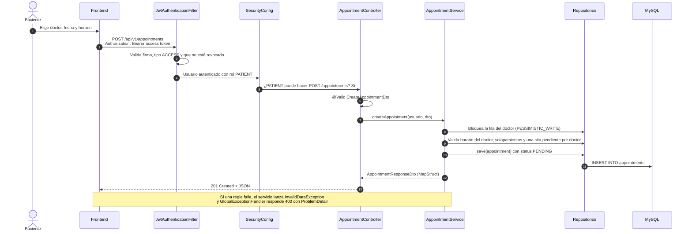

---

## 4. Seguridad

- **Sin sesión en el servidor** (`STATELESS`): cada petición trae su token.
- **Dos tokens JWT:** el *access token* (vida corta) se manda en cada petición; el *refresh token* (vida larga) solo sirve para pedir un par nuevo en `/auth/refresh-token`.
- **Tokens revocables:** cada token emitido se guarda como hash SHA-256 en `auth_tokens`. Un token con firma válida se rechaza si fue revocado: por logout, por un login nuevo (una sesión activa por usuario), por rotación del refresh, por desactivación del usuario o por cambio de email.
- **Contraseñas** con BCrypt.
- **Autorización en dos niveles:** `SecurityConfig` decide qué **rol** puede usar cada ruta, y los servicios verifican la **propiedad** (un paciente solo ve sus citas, un doctor solo completa las suyas). Cualquier ruta sin regla queda bloqueada (`denyAll`).

### 4.1 Login y uso del access token

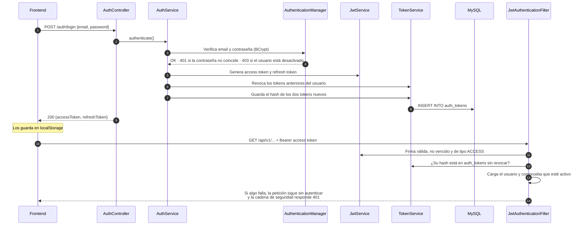

### 4.2 Renovación del token y logout

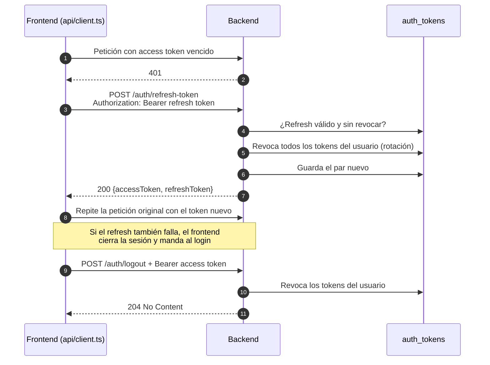

### 4.3 Permisos por rol

Resumen de `SecurityConfig`. ✅ = permitido · *propios* = el servicio además limita a los registros del usuario.

| Recurso | Admin | Recepción | Doctor | Paciente |
|---|:-:|:-:|:-:|:-:|
| Cuenta propia (`/account`) | ✅ | ✅ | ✅ | ✅ |
| Panel (`/dashboard`) | ✅ | ✅ | — | — |
| Recepcionistas: gestionar | ✅ | — | — | — |
| Pacientes: ver listado y detalle | ✅ | ✅ | ✅ | — |
| Pacientes: registrar en un paso / editar | ✅ | ✅ | — | — |
| Pacientes: completar y editar perfil propio | — | — | — | ✅ |
| Pacientes: activar / desactivar | ✅ | — | — | — |
| Expediente PDF | ✅ | — | ✅ | ✅ (propio) |
| Doctores, especialidades y horarios: consultar | ✅ | ✅ | ✅ | ✅ |
| Doctores, especialidades y horarios: crear y editar | ✅ | — | — | — |
| Citas: listado general | ✅ | ✅ | ✅ | — |
| Citas: "mis citas" | — | — | ✅ (propias) | ✅ (propias) |
| Citas: agendar, cancelar, reprogramar | ✅ | ✅ | — | ✅ (propias) |
| Citas: completar | — | — | ✅ (propias) | — |
| Historial: consultar de un paciente | ✅ | — | ✅ | ✅ (propio) |
| Historial: crear y editar entrada | — | — | ✅ (de su cita completada) | — |
| Hospitalizaciones: ver, crear, dar de alta | ✅ | ✅ | ✅ | ✅ (solo ver las propias) |
| Consumo de insumos | ✅ | — | ✅ | — |
| Salas: consultar | ✅ | ✅ | ✅ | — |
| Salas: crear y editar | ✅ | — | — | — |
| Inventario: consultar | ✅ | — | ✅ | — |
| Inventario: crear, editar, movimientos, stock bajo | ✅ | — | — | — |
| Archivos | ✅ | ✅ | ✅ (sus pacientes) | ✅ (propios) |

Públicas, sin token: `/auth/**`, `/swagger-ui.html`, `/v3/api-docs` y `/actuator/health`.

---

## 5. Ciclos de vida

**Cita**

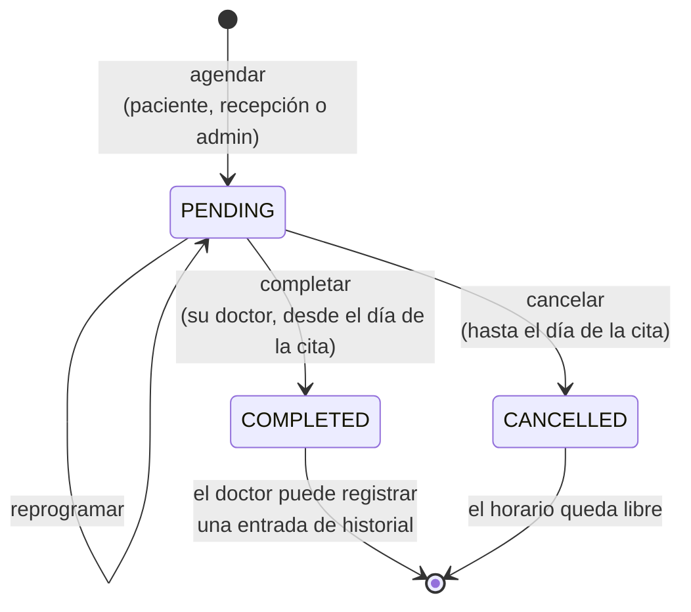

**Hospitalización**

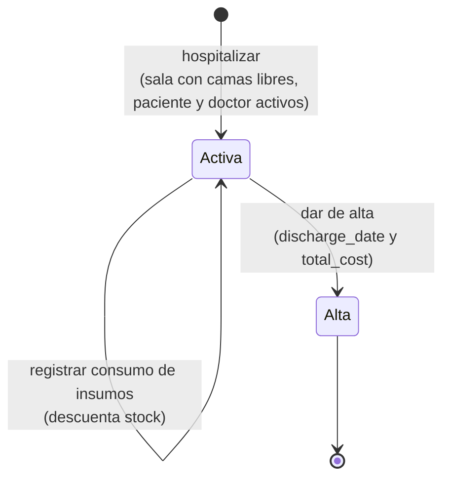

**Paciente y doctor:** se desactivan en lugar de borrarse. La desactivación se rechaza si tienen citas `PENDING` futuras o una hospitalización activa (propia o a su cargo). Un usuario inactivo no puede iniciar sesión y sus tokens quedan revocados.

---

## 6. Frontend

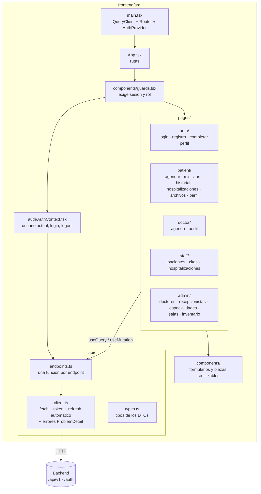

- **`api/client.ts`** es el único lugar que habla con el backend: agrega el access token, ante un 401 pide un par nuevo con el refresh token y repite la petición, y convierte los errores `ProblemDetail` en mensajes para la interfaz.
- **TanStack Query** guarda en caché las respuestas (`useQuery`) y las invalida después de crear o modificar (`useMutation`).
- **`guards.tsx`** protege las rutas: sin sesión manda al login; un paciente sin perfil completo, a completar perfil; con un rol sin permiso, a la página de inicio. Esto es solo comodidad para el usuario: la seguridad real la aplica el backend.
- En desarrollo, Vite reenvía `/api` y `/auth` al backend (`vite.config.ts`), así no hay problemas de CORS.
